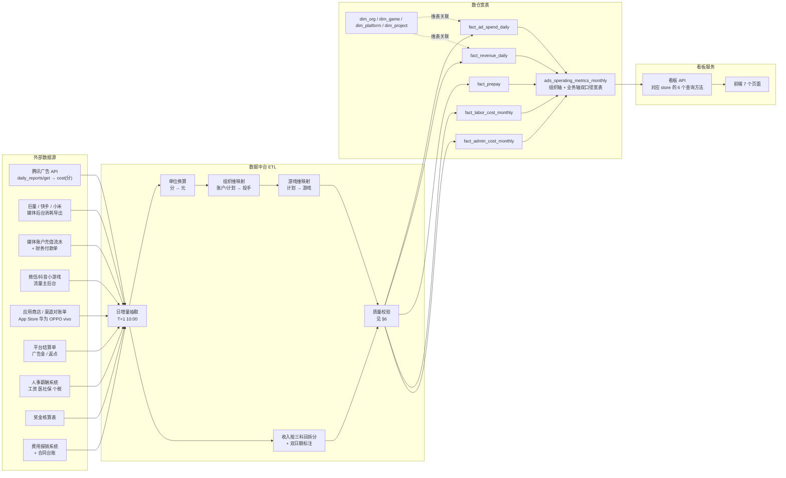

# 数据源与取数方案

> 版本：v0.1 ｜ 读者：数据开发 / 后端 / 数仓 ｜ 配套：`docs/02-模块开发契约.md`
>
> 本文只讲「数据从哪来、表怎么建、口径怎么算」，不重复 `docs/01` 的需求背景与 `docs/02` 的 API 契约。
>
> **数值可复现性说明**：本文出现的所有业务数字均由 `src/domain/store.ts` / `src/domain/dimensions.ts` 的常量与公式推导而来（默认筛选条件：`2025-07 ~ 2026-06`、`granularity=month`、`basis=operating`、`roiWindow=360`）。无法从代码推出的，一律显式标注「**示例值**」。

---

## 一、数据源全景

### 1.1 现状结论（先看这段，避免误判）

| 结论 | 说明 |
|---|---|
| **只有投放消耗有真实外部来源** | 媒体 API 的日消耗是唯一在原型仓库中已被验证过可取到的真实数据 |
| **预付成本 / 流量主收入 / 广告金 / 分成收入 四项目前没有真实接口** | 原型仓库中它们只是**手工配置字段**（人工在配置页/表里录入的系数或金额），不是从任何系统拉取的 |
| **在看板原型中，上述所有数据都是前端确定性 Mock** | `src/domain/store.ts` 用确定性伪随机 + 业务公式生成，无任何网络请求 |
| 因此本方案给的是**建议取数路径**，不是「已有接口清单」 | 落地时需要先按 §4 建表 + §6 校验规则，再逐项打通 |

### 1.2 管理数据（Management Data）

| 大类 | 明细项 | 建议来源系统 | 已有 / 需新建 | 更新频率 | 天然粒度 | 在看板中的字段 | 现状 |
|---|---|---|---|---|---|---|---|
| 人工成本 | 工资 | 人事薪酬系统（工资表） | 需对接 | 月（T+5） | 人 × 月 | `costByType.salary` | Mock |
| 人工成本 | 医社保 | 社保申报表 / 社保代缴平台 | 需对接 | 月（T+10） | 人 × 月 | `costByType.socialInsurance` | Mock |
| 人工成本 | 个税 | 个税申报表（自然人电子税务局导出） | 需对接 | 月（T+10） | 人 × 月 | `costByType.individualTax` | Mock |
| 人工成本 | 项目奖金 | 奖金核算表 / 人事系统 | 需对接 | 月 / 季 | 人 × 月 × 项目 | `costByType.projectBonus` | Mock |
| 管理费用 | 福利费 | 费用报销系统 + 人事福利台账 | 需对接 | 月 | 中心 × 月 | `costByType.welfare` | Mock |
| 管理费用 | 办公费 | 费用报销系统 / 合同台账 / 房租水电 | 需对接 | 月 | 中心 × 月 | `costByType.office` | Mock |

> 管理数据的粒度**天然比业务数据粗**：只能到「人 × 月」或「中心 × 月」，无法按天、无法直接按游戏。所以看板里人工/管理成本只能**按月挂到组织树上**，再通过分摊规则进入业务轴。

### 1.3 业务数据（Business Data）

| 大类 | 明细项 | 建议来源系统 / 接口 | 已有 / 需新建 | 更新频率 | 粒度 | 在看板中的字段 | 现状 |
|---|---|---|---|---|---|---|---|
| 业务成本 | **投放成本（消耗）** | 腾讯广告 `daily_reports/get` 的 **`cost` 字段** | **已有真实来源** | 日（T+1，当日 10:00 前） | 账户 × 广告组 × 日 | `costByType.adSpend` | Mock（但字段已验证） |
| 业务成本 | 预付成本（充值） | 媒体账户充值流水 / 财务付款单 | 需新建采集 | 日 / 按周 | 账户 × 支付日 | `costByType.prepay` | **无真实源，仅手工配置** |
| 业务收入 | 流量主收入 | 微信小游戏流量主后台 / 抖音小游戏后台 | 需新建采集 | 月（T+30~T+60） | 游戏 × 月 | `revenueByType.liuliangzhu` | **无真实源，仅手工配置** |
| 业务收入 | 广告金 | 平台结算单（广告金返还 / 返点） | 需新建采集 | 月 | 游戏 × 平台 × 月 | `revenueByType.adGold` | **无真实源，仅手工配置** |
| 业务收入 | 分成收入 | 应用商店 / 渠道对账单（App Store、华为、OPPO、vivo、小米） | 需新建采集 | 月（T+30~T+90） | 游戏 × 渠道 × 月 | `revenueByType.iapShare` | **无真实源，仅手工配置** |

**关于投放消耗的单位（必须注意）**：腾讯广告 `cost` 返回单位是**分**，入库前需 `cost / 100` 换算成**元**。看板内部一律用「元」为唯一金额单位，`@/utils/format` 的 `money()` 负责展示层压缩为万 / 亿。

### 1.4 建议取数优先级（按投入产出排序）

| 优先级 | 事项 | 理由 |
|---|---|---|
| P0 | 投放消耗接入腾讯广告 `daily_reports/get` | 唯一已验证的真实源；消耗是业务轴分摊基数，没有它整条业务轴都是空的 |
| P0 | 充值流水接入（媒体账户后台 + 财务付款单） | 账面口径的现金流出主体；`prepayBalance` / `cashGap` 全靠它 |
| P1 | 分成收入接入渠道对账单 | 占应确认收入约 40.7%（全期实测），金额大、来源清晰 |
| P1 | 流量主收入接入小游戏后台 | 占约 41.7%（全期实测），但后台导出能力差异大，需按平台分别写适配 |
| P2 | 广告金接入平台结算单 | 占约 17.6%，且「可提现 / 仅可抵扣」的拆分依赖平台结算单结构 |
| P2 | 人工成本对接人事系统 | 占成本大头（全期 3461.5 万含当月摊薄、整月口径 3614.8 万，约为业务成本的 23%），但月度手工导入可先顶住 |

---

## 二、指标口径定义表

覆盖 `docs/02` 契约 §3.3 中 `Metrics` 的**全部字段**。`basis` 决定「当前口径」三兄弟（`revenue` / `businessCost` / `profit`）取哪一支。

### 2.1 收入类

| 指标中文名 | 字段名 | 计算公式 | 单位 | 数据来源 | 是否预估 |
|---|---|---|---|---|---|
| 当前口径收入 | `revenue` | `basis='operating' ? accrualRevenue : cashRevenue` | 元 | 派生 | 经营口径为预估 |
| 应计确认收入 | `accrualRevenue` | `Σ_d spend(d)·f(t−d)`（见 `docs/04` §3） | 元 | 投放消耗 + 回收曲线 | **是（预估）** |
| 已到账收入 | `cashRevenue` | `Σ 三科目实际到账额`；原型=应计收入滞后 `platform.settleLagDays` 天 | 元 | 渠道/流量主对账单 | 否 |
| 流量主收入 | `revenueByType.liuliangzhu` | `accrualRevenue × iaaShare × liuliangzhuShare` | 元 | 小游戏流量主后台 | **是（按占比拆分）** |
| 广告金 | `revenueByType.adGold` | `accrualRevenue × iaaShare × (1 − liuliangzhuShare)` | 元 | 平台结算单 | **是（按占比拆分）** |
| 分成收入 | `revenueByType.iapShare` | `accrualRevenue × (1 − iaaShare)` | 元 | 渠道对账单 | **是（按占比拆分）** |

> 三科目合计恒等于 `accrualRevenue`（`iaaShare + (1−iaaShare) = 1`，`liuliangzhuShare + (1−liuliangzhuShare) = 1`）。
> 全期实测占比：流量主 8876.0 万（41.65%）、广告金 3754.0 万（17.61%）、分成 8682.8 万（40.74%）。
> ⚠️ `PlatformMeta.rebateRate`（腾讯 6% / 巨量 5% / 快手 4% / 小米 3%）目前在数据引擎中**未被消费**，仅作为平台元数据存在；广告金在原型中完全由 `iaaShare × (1 − liuliangzhuShare)` 决定。

### 2.2 成本类

| 指标中文名 | 字段名 | 计算公式 | 单位 | 数据来源 | 是否预估 |
|---|---|---|---|---|---|
| 当前口径业务成本 | `businessCost` | `basis='operating' ? spend : prepay` | 元 | 派生 | 否 |
| 人工成本 | `laborCost` | `salary + socialInsurance + individualTax + projectBonus` | 元 | 薪酬系统 | 否（月度实发） |
| 管理费用 | `adminCost` | `welfare + office` | 元 | 报销系统 / 福利台账 | 否 |
| 当前口径总成本 | `totalCost` | `businessCost + laborCost + adminCost` | 元 | 派生 | 否 |
| 投放成本 | `costByType.adSpend` | `Σ 各组合当日实际消耗`（**非充值额**） | 元 | 媒体 API `cost/100` | 否 |
| 预付成本 | `costByType.prepay` | `Σ 各投手按周充值额`，原型= `ceil(周消耗×1.05 / 1万)×1万` | 元 | 媒体账户充值流水 | 否（现金流） |
| 工资 | `costByType.salary` | 当月应发（基本+绩效） | 元 | 薪酬系统 | 否 |
| 医社保 | `costByType.socialInsurance` | `salary × 28%`（公司承担部分） | 元 | 社保申报表 | 否 |
| 个税 | `costByType.individualTax` | `salary × 6%`（公司代扣代缴现金流口径） | 元 | 个税申报表 | 否 |
| 项目奖金 | `costByType.projectBonus` | 原型：季末月（`月序 % 3 == 0`）= `salary × 0.8 × 绩效系数` | 元 | 奖金核算表 | 否 |
| 福利费 | `costByType.welfare` | `中心人工成本 × 4.5%` | 元 | 报销系统 | 否 |
| 办公费 | `costByType.office` | `中心人头 × 2600 元/人/月` | 元 | 报销/合同台账 | 否 |

### 2.3 利润与效率类

| 指标中文名 | 字段名 | 计算公式 | 单位 | 数据来源 | 是否预估 |
|---|---|---|---|---|---|
| 当前口径利润 | `profit` | `basis='operating' ? operatingProfit : bookProfit` | 元 | 派生 | 经营口径含预估 |
| 当前口径利润率 | `margin` | `revenue > 0 ? profit / revenue : 0` | 小数 | 派生 | — |
| 账面利润 | `bookProfit` | `cashRevenue − prepay − laborCost − adminCost` | 元 | 银行/媒体流水 | 否 |
| 经营利润 | `operatingProfit` | `accrualRevenue − spend − laborCost − adminCost` | 元 | 派生 | **是（预估）** |
| 口径差额 | `profitGap` | `operatingProfit − bookProfit` | 元 | 派生 | 含预估 |
| 账面利润率 | `bookMargin` | `cashRevenue > 0 ? bookProfit / cashRevenue : 0` | 小数 | 派生 | 否 |
| 经营利润率 | `operatingMargin` | `accrualRevenue > 0 ? operatingProfit / accrualRevenue : 0` | 小数 | 派生 | 是 |
| 投放消耗 | `spend` | `Σ 本期各组合日消耗` | 元 | 媒体 API | 否 |
| 充值额 | `prepay` | `Σ 本期充值` | 元 | 媒体账户 | 否 |
| 预付余额（时点） | `prepayBalance` | `max(0, Σ累计充值 − Σ累计消耗)` | 元 | 派生 | 否 |
| 应收未收（时点） | `receivable` | `max(0, 累计预估总回收 − 累计已确认回收)` | 元 | 派生 | **是（预估）** |
| 现金缺口（时点） | `cashGap` | `prepayBalance + receivable` | 元 | 派生 | 含预估 |
| 累计预估 ROI | `forecastRoi` | `累计预估总回收 / 累计消耗`（窗口取 `filter.roiWindow`） | 倍 | 派生 | **是（预估）** |
| 累计实际 ROI | `actualRoi` | `累计已确认回收 / 累计消耗` | 倍 | 派生 | 含预估（回收曲线） |
| 累计回收完成度 | `recoveryRate` | `累计已确认回收 / 累计预估总回收` | 小数 | 派生 | 是 |
| 人效比 | `efficiencyRatio` | `operatingProfit / laborCost`（`laborCost > 0`） | 倍 | 派生 | 是 |
| 人数（时点） | `headcount` | 组织子树人头；**区间取最后一个月**，不按月累加、不摊薄 | 人 | 组织维表 | 否 |
| 人均经营利润 | `perCapitaProfit` | `operatingProfit / headcount` | 元/人 | 派生 | 是 |

> ⚠️ **两条口径提醒**：
> ① **累计口径**：`forecastRoi` / `actualRoi` / `recoveryRate` 是**自数据起点（2024-01）累计口径**，不随 `startMonth` 变化（`finishAgg` 取区间末月的 `cum*` 字段）。UI 文案必须写「累计」二字。实测：单独筛选 `2026-06` 一个月时，三项仍返回累计值（1.4619 / 1.3605 / 0.9306）而非当月值。
> ② **当月摊薄**：`laborCost` / `adminCost` 在**包含当月的区间**里按当月已过天数比例计入（`prorationOf()` = 18/30 = 0.6），已结束月份为 1、未来月份为 0。因此「全期人工成本 3461.5 万」是**含摊薄**的值；同一期间若按整月口径还原，人工为 3614.8 万。见 §3.1 与 §5。

实测全期（默认筛选，含当月摊薄，单位：万元）：

| 指标 | 值 | 指标 | 值 |
|---|---|---|---|
| 应计确认收入 | 21312.8 | 应付人工成本 | 3461.5 |
| 已到账收入 | 21423.2 | 管理费用 | 394.0 |
| 投放消耗 | 15149.5 | **经营利润** | **2307.8** |
| 充值额 | 17736.0 | **账面利润** | **−168.4** |
| 预付余额 | 5108.3 | **口径差额** | **2476.2** |
| 应收未收 | 3071.6 | 现金缺口 | 8180.0 |

---

## 三、两条聚合轴的设计

### 3.1 组织轴：成本直接归集，收入按人归属

```
公司(company)
 └─ 中心(center) ×4  ── 研发中心 / 发行中心 / 中台 / 职能中心
     └─ 部门(department) ×9
         └─ 小组(group) ×17
             └─ 投手/员工(pitcher) ×79（其中真正的投手 19 人）
```

| 环节 | 处理方式 | 实现位置 |
|---|---|---|
| 投放消耗、应计收入、到账收入 | **按人直接归属**：从 `scope.campaignIds` 里筛出该节点下投手的投放组合，再逐级上卷（**与业务筛选同源**，见 §3.3 表末） | `campaignsOfOrgNode()` + `sumCampaigns()` |
| 人工成本 4 科目 | **按人直接归集**到本人节点，子树求和即上级成本 | `ORG_OWN_COST`（pitcher 节点持有） |
| 管理费用 2 科目 | **按人头下沉到中心内每一个人**：先算 福利费 = 中心人工成本 × 4.5%、办公费 = 中心人头 × 2600 元，再按人头均摊给成员（**中心节点自身置零**，避免与下属重复计入） | `ORG_OWN_COST` 的中心下沉循环 |
| 部门 / 小组节点 | 无自身成本，全部来自子树求和 | `orgCostOf()` → `subtreeIds()` |
| **当月摊薄** | 人工工资、医社保、办公费等固定成本按**当月已过天数比例**确认（`prorationOf()` = 18/30 = 0.6）；已结束月份恒为 1，未来月份为 0。人头始终取时点值、不摊薄 | `prorationOf()` / `costOfIds()` |

> **为什么管理费用必须下沉到人（已修复的历史问题）**：早期实现把管理费用只挂在**中心节点**上，导致 `department` / `group` / `pitcher` 三层汇总漏掉管理费，「Σ部门」比公司合计**多出恰好等于 `adminCost` 的金额**（当时实测 409.1 万）。下沉后四层汇总全部勾稽到公司合计（实测差额 **0.00 万元**）。此处记录以免再次踩坑。

实测（默认筛选，单位：万元）：

| 中心 | 应计收入 | 投放消耗 | 人工成本 | 管理费用 | 经营利润 | 人数 | 人效比 |
|---|---|---|---|---|---|---|---|
| 研发中心 | 0 | 0 | 1140.2 | 114.6 | −1254.9 | 21 | −1.10 |
| 发行中心 | 21312.8 | 15149.5 | 1528.9 | 186.4 | 4448.0 | 39 | 2.91 |
| 中台 | 0 | 0 | 563.5 | 58.5 | −622.0 | 11 | −1.10 |
| 职能中心 | 0 | 0 | 228.9 | 34.4 | −263.3 | 8 | −1.15 |
| **Σ 四中心** | **21312.8** | **15149.5** | **3461.5** | **394.0** | **2307.8** | **79** | — |

**成本中心的呈现特点**：研发 / 中台 / 职能中心**没有投放、没有收入**，在组织轴上表现为纯负利润节点（利润 = −人工 − 管理）。这是正确且必要的：组织轴回答「谁在赚钱」，成本中心参与分摊是它在业务轴上的义务，而在组织轴上它就是成本。

**组织轴已响应业务筛选**（实测 `gameIds=['g16']`，单位万元）：

| 视图 | 投放消耗 |
|---|---|
| 公司合计 | 101.1 |
| Σ 中心（研发 0 / **发行 101.1** / 中台 0 / 职能 0） | 101.1 |
| Σ 部门 / Σ 游戏 / Σ 平台 | 101.1 / 101.1 / 101.1 |

> 早期实现按组织维度预聚合，**组织轴不跟随平台/项目/游戏筛选**，会出现「公司消耗 101 万 vs 组织轴消耗 1.5 亿」的口径矛盾。现已统一为「从 `scope.campaignIds` 筛出该节点下投手的组合」，与公司合计同源。这同样是**已修复**的历史问题。
>
> ⚠️ 提示：按单个游戏筛选时，组织轴上**没有投放的中心会成为大额负利润节点**（如上面 `g16` 场景公司经营利润为 −3908 万元）。这不是 bug——所有人工/管理费用仍按整公司口径计入，而收入只来自 `g16` 一个游戏。做单游戏口径分析时应看**业务轴**（成本按消耗占比分摊），不要看组织轴。

### 3.2 业务轴：成本池按投放消耗占比分摊

```
公司(company)
 └─ 平台(platform) ×4  ── 腾讯广告 / 巨量引擎 / 快手磁力 / 小米营销
     └─ 项目(project) ×6
         └─ 游戏(game) ×16
```

| 环节 | 处理方式 | 实现位置 |
|---|---|---|
| 投放消耗 / 应计收入 / 到账收入 | 按组合的 `platformId / projectId / gameId` 直接归属 | `CAMPAIGN_MONTH` + `sumCampaigns` |
| **成本池** | `pool = 全公司（或筛选组织范围内）的人工成本 + 管理费用` | `poolOf(scope)` |
| **分摊** | `节点成本 = pool × (节点本期消耗 / 筛选范围内总消耗)` | `businessMetrics()` 中的 `share` |
| 无消耗节点 | `share = 0` → 成本 0、利润 0（避免除零） | `totals.flow.spend > 0 ? … : 0` |
| **范围过滤时的成员裁剪** | 显式业务/组织筛选生效时，**隐藏该维度下没有任何投放的成员**（除非用户显式选中了它），避免「按平台筛选后仍列出全部项目」这类空行 | `queryRows()` 中的 `bizFilterActive` / `hasCampaign` |

实测：6 个项目的 `spendShare` 与 `laborShare`、`adminShare` **完全相等**（同一个比例），验证分摊逻辑：

| 项目 | 投放消耗（万） | 消耗占比 = 人工占比 = 管理占比 |
|---|---|---|
| 卡牌项目 | 3699.8 | 24.42% |
| 消除项目 | 3103.4 | 20.49% |
| 传奇项目 | 2489.6 | 16.43% |
| 模拟经营项目 | 1504.3 | 9.93% |
| 塔防项目 | 1404.1 | 9.27% |
| 休闲竞技项目 | 2948.3 | 19.46% |

**平台筛选下的项目行已被正确裁剪**（实测）：`platformIds=['pf1']` → 只返回 `pj1, pj2, pj3, pj5`；`platformIds=['pf4']` → 只返回 `pj3, pj6`。（早期实现会返回全部 6 个项目，含不归属该平台的空行，已修复。）

### 3.3 为什么两条轴的公司合计口径一致

两条轴用的是**同一份事实数据**与**同一份成本池**，只是归集路径不同：

```
组织轴公司合计 = Σ_中心 (Σ_人 投放/收入)  + Σ_中心 (人工成本 + 管理费用)
业务轴公司合计 = Σ_平台 (Σ_组合 投放/收入) + Σ_平台 (pool × 该平台消耗占比)
                                            └ 因 Σ 消耗占比 = 1，故 Σ 分摊成本 = pool
```

三个保证一致的条件（实测均已满足）：

| # | 条件 | 实测验证 |
|---|---|---|
| 1 | 收入只由组合产生，两轴的组合集合相同 | 组织轴 Σ收入 = 业务轴 Σ收入 = 21312.8 万 = 公司 |
| 2 | 成本池恰好被分摊一次，占比之和为 1 | Σ_项目 消耗 = 15149.5 万 = 公司；Σ_项目 labor = 3461.5 万 = 公司；Σ_项目 admin = 394.0 万 = 公司 |
| 3 | 没有成本同时被「直接归集」与「分摊」计入 | 组织轴用 `ORG_OWN_COST`（管理费用已下沉到人），业务轴用 `pool × share`，两套互不叠加 |

✅ 实测结果（**更新后**）：`company` / `center` 汇总 / `department` 汇总 / `group` 汇总 / `pitcher` 汇总 / `platform` 汇总 / `project` 汇总 / `game` 汇总的 `operatingProfit` **全部等于 2307.8 万元**（各层差额 0.00 万），`accrualRevenue` 全部等于 **21312.8 万元**。

> 全期口径（含当月按 18/30 摊薄的固定成本）：应计收入 21312.8 万、人工成本 3461.5 万、管理费用 394.0 万、经营利润 **2307.8 万**、账面利润 **−168.4 万**、口径差额 **2476.2 万**。

### 3.4 分摊规则切换的影响（给财务的敏感性提示）

若把业务轴分摊基数从「投放消耗占比」换成「人头占比」，**公司合计不变**，但分布显著变化。全公司 79 人中发行中心 39 人、其他中心 40 人；而投放消耗 **100% 来自发行中心**，所以：

| 情形 | 投放中心的成本负担 |
|---|---|
| 消耗占比（当前实现） | 承担 **100%** 的成本池（3855.5 万元） |
| 人头占比（备选） | 只承担 **49.4%**（39/79） |

对应项目经营利润变化（单位：万元；消耗占比口径 = 引擎实际输出，人头占比口径为**示例值**，按各项目去重投手人数占比构造）：

| 项目 | 应计收入 | 投放消耗 | 消耗占比口径 op | 人头占比口径 op（示例） | 分摊差额 |
|---|---|---|---|---|---|
| 卡牌项目 | 4906.5 | 3699.8 | 265.1 | 597.9 | +332.8 |
| 消除项目 | 4856.1 | 3103.4 | 963.0 | 941.1 | −21.9 |
| 传奇项目 | 4354.0 | 2489.6 | 1230.8 | 1323.3 | +92.5 |
| 模拟经营项目 | 1593.1 | 1504.3 | −294.0 | −587.6 | −293.6 |
| 塔防项目 | 1474.0 | 1404.1 | −287.5 | −403.7 | −116.1 |
| 休闲竞技项目 | 4129.1 | 2948.3 | 430.4 | 436.7 | +6.3 |

> 结论：**分摊基数是一个业务决策，不是技术细节**。两种口径下差额可达 ±330 万元，足以让「项目盈利/亏损」的结论翻转。人头占比会把成本推给「人多但消耗少」的项目。建议在参数配置页保留开关（`docs/01` §4.3 已提出），并在页面上明示当期用的是哪种。

---

## 四、建议的物理表设计

共 7 张表：4 张事实表 + 3 张维表。金额单位统一**元**（`DECIMAL(18,2)`），比率用 `DECIMAL(9,6)`。

### 4.1 `fact_ad_spend_daily` 投放日消耗

| 字段 | 类型 | 说明 |
|---|---|---|
| `stat_date` | DATE | 统计日期 |
| `pitcher_id` | VARCHAR(32) | 投手（组织维，最细粒度） |
| `platform_id` | VARCHAR(16) | 平台 |
| `game_id` | VARCHAR(16) | 游戏 |
| `account_id` | VARCHAR(64) | 媒体账户 id（对账用） |
| `campaign_id` | VARCHAR(64) | 广告计划 id（素材/版位分析用） |
| `cost_cent` | BIGINT | **媒体原始返回值，单位：分** |
| `cost_yuan` | DECIMAL(18,2) | `cost_cent / 100`，看板唯一使用口径 |
| `impressions` | BIGINT | 曝光（诊断素材用，可空） |
| `clicks` | BIGINT | 点击（可空） |
| `etl_time` | DATETIME | 入库时间（幂等重跑用） |

- **主键**：`(stat_date, campaign_id)`
- **更新频率**：日增，T+1，当日 10:00 前完成
- **来源**：腾讯广告 `daily_reports/get`（`cost` → `/100`）

### 4.2 `fact_revenue_daily` 收入日流水

| 字段 | 类型 | 说明 |
|---|---|---|
| `stat_date` | DATE | **应计日期**（收入归属期间，权责发生制用） |
| `settle_date` | DATE | **到账日期**（账面口径用；`NULL` = 未到账） |
| `game_id` | VARCHAR(16) | 游戏 |
| `platform_id` | VARCHAR(16) | 平台 / 渠道 |
| `subject` | VARCHAR(16) | 科目：`liuliangzhu` / `ad_gold` / `iap_share` |
| `gross_amount` | DECIMAL(18,2) | 分成前流水（渠道对账用） |
| `net_amount` | DECIMAL(18,2) | 分成后净额（看板使用口径） |
| `withdrawable` | TINYINT | 广告金专用：1=可提现，0=仅可抵扣投放 |
| `source_batch` | VARCHAR(64) | 对账单批次号 |
| `etl_time` | DATETIME | 入库时间 |

- **主键**：`(stat_date, game_id, platform_id, subject)`
- **更新频率**：日增占位 + 月度对账单回填（`settle_date` 在 T+30~T+90 才落地）
- **双日期口径**：账面取 `settle_date`，经营取 `stat_date`，二者差额即「在途收入」

### 4.3 `fact_prepay` 充值流水

| 字段 | 类型 | 说明 |
|---|---|---|
| `pay_date` | DATE | 支付/充值日期 |
| `pitcher_id` | VARCHAR(32) | 充值责任人（组织轴归属） |
| `platform_id` | VARCHAR(16) | 平台 |
| `account_id` | VARCHAR(64) | 媒体账户 |
| `pay_amount` | DECIMAL(18,2) | 充值金额（含赠送，`payment_amount + bonus_amount`） |
| `payment_amount` | DECIMAL(18,2) | 实付金额 |
| `bonus_amount` | DECIMAL(18,2) | 平台赠送金额 |
| `voucher_no` | VARCHAR(64) | 付款单号 |

- **主键**：`(pay_date, account_id, voucher_no)`
- **更新频率**：日增
- **预付余额**（视图或宽表字段）：`prepay_balance(account, t) = Σ_{d≤t} pay_amount − Σ_{d≤t} cost_yuan`

### 4.4 `dim_org` 组织维表

| 字段 | 类型 | 说明 |
|---|---|---|
| `org_id` | VARCHAR(32) | 主键（原型 id 形如 `c2d1g1p3`） |
| `org_name` | VARCHAR(64) | 名称 |
| `level` | VARCHAR(16) | `company` / `center` / `department` / `group` / `pitcher` |
| `parent_id` | VARCHAR(32) | 汇报关系（`NULL` = 公司根） |
| `owner` | VARCHAR(64) | 负责人；叶子为本人 |
| `headcount` | INT | 子树人头（叶子 = 1） |
| `is_pitcher` | TINYINT | 是否可直接投放 |
| `join_month` | CHAR(7) | 入职月份 `YYYY-MM`，**人力成本从该月起计** |
| `leave_month` | CHAR(7) | 离职月份，`NULL` = 在职 |
| `center_id` | VARCHAR(16) | 冗余中心 id（加速中心级聚合） |

- **主键**：`org_id`
- **更新频率**：日增（人事变更 T+1）；历史月份需保留**缓慢变化维**（`valid_from` / `valid_to`），否则历史成本会随组织调整而漂移

### 4.5 `dim_game` 游戏维表

| 字段 | 类型 | 说明 |
|---|---|---|
| `game_id` | VARCHAR(16) | 主键 |
| `game_name` | VARCHAR(64) | 名称 |
| `project_id` | VARCHAR(16) | 所属项目 |
| `monetize` | VARCHAR(8) | `iaa` / `iap` / `mix` |
| `iaa_share` | DECIMAL(9,6) | 总回收中 IAA 占比（`0~1`） |
| `liuliangzhu_share` | DECIMAL(9,6) | IAA 内流量主占比（`0~1`） |
| `curve_a` | DECIMAL(9,6) | 回收曲线斜率（**必须 > 0**） |
| `curve_b` | DECIMAL(9,6) | 首日回收率 = `ROI(1)` |
| `payback_days` | INT | 目标回本周期（天） |
| `red_line_roi` | DECIMAL(9,6) | ROI 红线，低于则预警 |
| `online_month` | CHAR(7) | 上线月份 `YYYY-MM`，**上线前不许有消耗** |
| `stage` | VARCHAR(8) | `测试期` / `成长期` / `成熟期` / `衰退期` |
| `key_game` | TINYINT | 是否重点游戏 |

- **主键**：`game_id`
- **更新频率**：参数按月重新拟合后更新（`curve_a` / `curve_b`）；`stage` 按业务评审更新

### 4.6 `fact_labor_cost_monthly` 人工成本月表

| 字段 | 类型 | 说明 |
|---|---|---|
| `month` | CHAR(7) | 账期 `YYYY-MM` |
| `person_id` | VARCHAR(32) | 人员 id（= `dim_org` 的 pitcher 节点） |
| `org_id` | VARCHAR(32) | 冗余归属小组 |
| `salary` | DECIMAL(18,2) | 工资（基本+绩效） |
| `social_insurance` | DECIMAL(18,2) | 医社保公司承担 |
| `individual_tax` | DECIMAL(18,2) | 代扣代缴个税 |
| `project_bonus` | DECIMAL(18,2) | 项目奖金 |
| `bonus_project_id` | VARCHAR(16) | 奖金归属项目（`NULL` = 未指向具体项目） |
| `headcount` | INT | 计薪人头（在离职工资拆分时为小数） |

- **主键**：`(month, person_id)`
- **更新频率**：月增，T+10

### 4.7 `fact_admin_cost_monthly` 管理费用月表

| 字段 | 类型 | 说明 |
|---|---|---|
| `month` | CHAR(7) | 账期 |
| `center_id` | VARCHAR(16) | **计提归属中心**（福利费/办公费的计提口径是中心） |
| `alloc_person_id` | VARCHAR(32) | **实际承担人**（引擎按人头把管理费下沉到中心内每个人；未下沉时可留 `NULL`） |
| `subject` | VARCHAR(16) | `welfare` / `office` |
| `amount` | DECIMAL(18,2) | 金额 |
| `basis_note` | VARCHAR(128) | 计提依据备注（如「中心人工成本×4.5%」「中心人头×2600元/月」） |
| `voucher_no` | VARCHAR(64) | 报销单/合同号 |

- **主键**：`(month, center_id, subject, COALESCE(alloc_person_id,''))`
- **更新频率**：月增，T+10
- **下沉口径**：`人员承担额 = 中心计提额 / 中心人头`（同时点、同中心内均摊）。引擎侧这样做的原因是让 `department` / `group` / `pitcher` 三层汇总都能勾稽到公司合计；若数仓选择「计提在中心、承担在中心」的形态，则需要在下游聚合层显式实现同一套下沉规则，否则各层汇总不闭合。

---

## 五、取数链路图



**看板 API 与数据引擎的对应关系**（替换为真实接口时按此映射）：

| `store` 方法 | 建议 API | 主要依赖表 |
|---|---|---|
| `queryRows(filter, groupBy)` | `GET /api/operating/rows?groupBy=` | `ads_operating_metrics_monthly` |
| `metricsOf(filter, groupBy, key)` | `GET /api/operating/metrics` | 同上 |
| `querySeries(filter)` / `queryMonthSeries(filter)` | `GET /api/operating/series` | 同上 |
| `alerts(filter)` | `GET /api/operating/alerts` | 宽表 + `dim_game.red_line_roi` |
| `forecast(filter, horizon)` | `GET /api/operating/forecast` | 宽表 + `dim_game` 曲线参数 |
| `cohorts(filter, count)` | `GET /api/operating/cohorts` | `fact_ad_spend_daily` + 曲线参数 |
| `project(filter, opts)` | `POST /api/operating/project`（what-if 沙盒） | 同 `forecast`，另接受 `spendScale / curveAScale / curveBScale / laborScale / platformIds / gameIds` |
| `orgCostOf(orgId, monthIdx)` | `GET /api/operating/org-cost` | `fact_labor_cost_monthly` + `fact_admin_cost_monthly` + `dim_org` |

**当月摊薄必须在服务端实现**：`prorationOf()` = 当月已过天数 / 当月天数（本期为 18/30 = 0.6）。人工、医社保、办公费等是**整月发生**的固定成本，而业务数据只到 `TODAY`。若不做摊薄，任何包含当月的区间都会把整月固定成本计进来，把「当月已实现经营利润」压成大额负数，与当月全月预估自相矛盾。API 层要显式区分两种口径：

| 场景 | 用的口径 | 引擎函数 |
|---|---|---|
| 已实现区间指标（`metricsOf` / `queryRows` / `querySeries`） | **摊薄** `costOfIds()` | `prorationOf()` |
| 当月**全月**预估、未来月预估 | **整月** `rawCostOfIds()` | 不摊薄 |

---

## 六、数据质量校验规则

| # | 校验对象 | 规则 | 失败处理 |
|---|---|---|---|
| 1 | `fact_ad_spend_daily.cost_yuan` | 必须 `>= 0`（消耗不允许为负） | 该行置 `NULL` 并写入 `dq_reject` 表，告警到数据群；**不阻塞**其余行入库 |
| 2 | `fact_prepay.pay_amount` | 必须 `> 0`；负数（退款）单独走 `refund` 类型，不得混入 | 拒绝入库，人工确认后按退款单补录 |
| 3 | 预付余额 | `Σ充值 − Σ消耗 >= 0`（账户级、日级） | 若为负 → 判为「消耗取数缺失或充值未同步」：**不修正数值**，只打标签 `dq_flag=prepay_negative`，看板展示时对该账户区间降级为「数据待核」 |
| 4 | `fact_revenue_daily` | `settle_date >= stat_date`，且 `stat_date >= 该游戏 online_month-01` | 违规行挂起待人工核对；确认后修正 `stat_date` 并重跑下游 |
| 5 | `fact_revenue_daily.net_amount` | `0 < net_amount <= gross_amount`（分成后不得大于分成前） | 拒绝入库；常见原因是渠道对账单单位错误（分/元） |
| 6 | 收入三科目 | 同一 `(stat_date, game_id, platform_id)` 下三科目金额均 `>= 0`，且 `Σ三科目` 与对账单总额差异 `<= 0.5%` | 差异超阈值 → 不发布该批次，回退上一批次数据 |
| 7 | `dim_game` 曲线参数 | `curve_a > 0` 且 `curve_b >= 0` 且 `curve_b <= 1`；`iaa_share ∈ [0,1]`、`liuliangzhu_share ∈ [0,1]` | 参数不合法 → **按实现**：清理该游戏的曲线字段，引擎会落到**全局硬编码兜底值 `curveA=0.2, curveB=0.15`**（`recoveryRateFor()` 中 `g?.curveA ?? 0.2`）。⚠️ 引擎**没有「回退到平台均值」这一层**（详见 `docs/04` §7.4）；若业务要求平台级回退，需在取数层显式实现后再启用该规则 |
| 8 | `dim_org` 组织树 | ① 无环（从任意节点回溯必达 `company`）② 每个非根节点 `parent_id` 非空且存在 ③ 层级顺序必须是 company→center→department→group→pitcher | 拒绝该批次组织维发布；看板沿用上一版本组织树并提示「组织数据待更新」 |
| 9 | 月度人工成本 | `Σ fact_labor_cost_monthly.headcount` == 花名册在职人数时点值；差异 `<= 1` 人 | 差异超阈值 → 阻断该月成本发布，人工核对入离职月份（`join_month` / `leave_month`） |
| 10 | 管理费用计提 | 福利费 == 中心人工成本 × `WELFARE_RATE`（容差 ±1%）；办公费 == 中心人头 × `OFFICE_COST_PER_HEAD`（容差 ±1%） | 超出容差 → 标记 `basis_note` 为「人工调整」，并在成本分析页单独列出，不计入自动分摊池 |
| 11 | 游戏生命周期阶段 | `stage='衰退期'` ⇒ 该游戏应存在 `end_month`（停止投放）；`stage='测试期'` ⇒ `online_month` 距今 `<= 12` 个月 | 不一致 → 生成数据治理工单，不阻断看板 |
| 12 | 曲线自洽性 | 由 `curveA/curveB` 反解的回本天数 `n = exp((1−curveB)/curveA)` 与 `payback_days` 偏差 `<= 60%` | 超差 → 提示「曲线参数与目标回本周期矛盾」，要求算法同学重拟合（**原型数据中 16 个游戏有 10 个触发此规则，详见 `docs/04` §6**） |
| 13 | 消耗-充值勾稽 | 任意账户任意自然周：`Σ消耗 <= Σ充值 × 1.1`（预留赠送额度） | 超限 → 视为消耗或充值取数不完整，该周数据打 `dq_flag=incomplete`，不得用于分摊（分母清零） |
| 14 | 数据新鲜度 | `fact_ad_spend_daily` 最新日期 `>= 昨天`（T+1 到位） | 未到位 → 看板顶部提示「消耗数据截至 X 日」，成本分摊按已有数据计算并标注 |
| 15 | 管理费用下沉勾稽 | 同一中心、同一月：`Σ 成员承担额 == 中心计提额`（容差 ±1 元，即 `welfare + office` 逐人摊分后不得丢分） | 不闭合 → 拒绝该月管理费发布；这是「各层级汇总 = 公司合计」的必要条件（见 §3.1） |
| 16 | 各层汇总勾稽（跨轴一致性） | `Σ center.op == Σ department.op == Σ group.op == Σ pitcher.op == Σ platform.op == Σ project.op == Σ game.op == company.op`（容差 ±0.01 元） | 任一不等 → 阻断发布并定位该层级；实测现值全部为 **2307.8 万元** |
| 17 | 当月固定成本摊薄 | 当月 `labor + admin` 必须等于整月值 × （已过天数 / 当月天数）；`headcount` 保持时点值不摊薄 | 不等 → 说明摊薄逻辑被绕过，会在含当月的区间里产生「当月巨亏」假象 |

---

## 七、遗留问题（需主控 / 业务决策）

1. **`PlatformMeta.rebateRate` 未被消费**：当前广告金完全由 `iaaShare × (1−liuliangzhuShare)` 决定，平台返点率没有进入任何计算。若广告金要按返点率单独建账，需要新增数据通路。
2. **`basis='book'` 的业务成本用充值额替代**：`businessCost(book) = prepay`。真实落地时账面口径的业务成本建议用「已付投放款（充值）」+「预付摊销」两段式，而不是直接用充值额。
3. **极限筛选下组织轴会出现大额负利润（口径正确但易误读）**：按单个游戏筛选时，组织轴会把整公司的人工/管理费用全额计入，而收入只来自该游戏，于是出现大额负利润（如 `gameIds=['g16']` 时公司消耗 101.1 万、经营利润 −3908 万元）。建议 UI 在组织轴视图下加提示：「跨游戏分摊请切到业务轴」。相关边界见 §3.1 末尾。

**已在本文档记录、并已由主控修复完成的三条历史问题**（保留供追溯，不再是遗留项）：

| # | 历史问题 | 现状 | 详见 |
|---|---|---|---|
| 1 | 管理费用只挂中心节点，导致 `department` / `group` / `pitcher` 三层汇总不闭合（差额恰为 `adminCost`） | 已改为按人头下沉到人，四层汇总全部等于公司合计 | §3.1 |
| 2 | 组织轴不跟随平台/项目/游戏筛选；业务轴项目层在平台筛选下多返回空行 | 组织轴改用 `campaignsOfOrgNode()`；业务轴已裁剪无投放成员 | §3.1 / §3.2 |
| 3 | `forecast()` 与 `project()` 两份未来月实现导致月收入差 1%~9% | 已统一：`projectMonths()` 成为未来月唯一实现，两者 `scale = 1` 时逐月差额 **0.00 万** | `docs/04` §5.4 |
